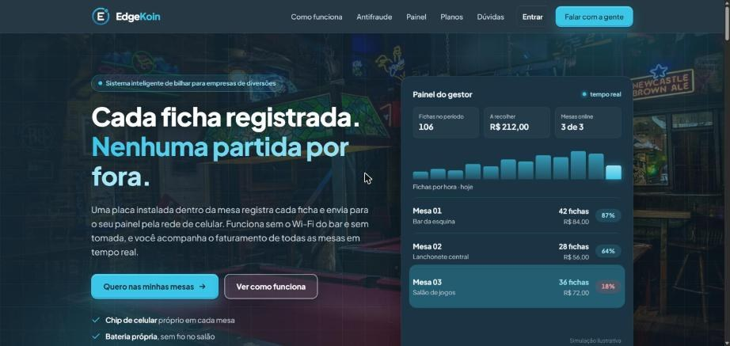
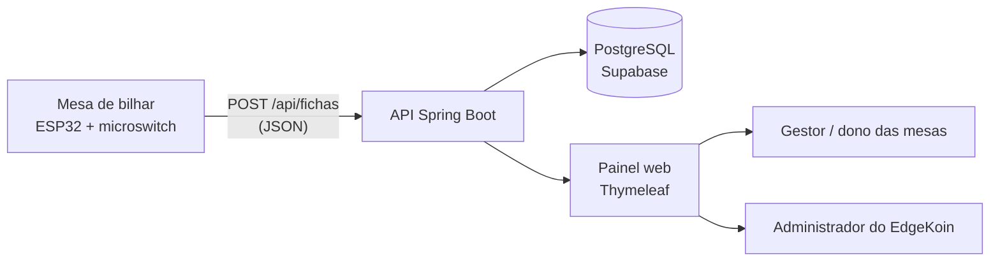
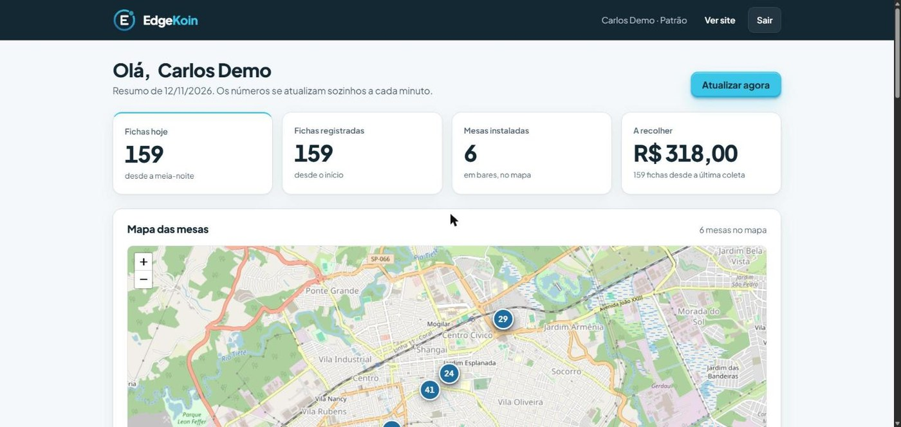
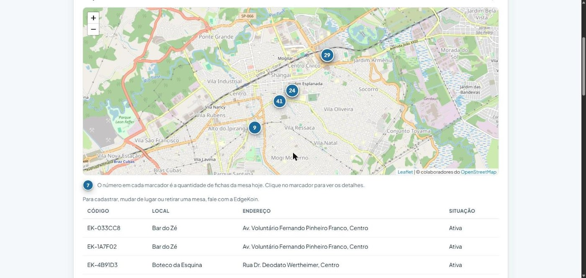
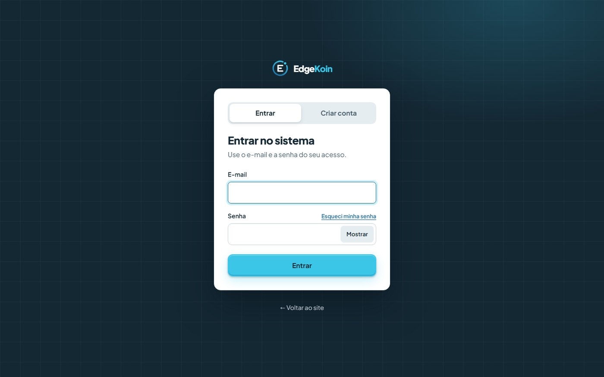

<h1 align="center">EdgeKoin</h1>

  <b>Sistema IoT para mesas de bilhar de ficha: cada ficha registrada, nenhuma partida por fora.</b>

  
  
  
  
  
  

  

> **Sobre este repositório:** esta é a vitrine do projeto, com descrição, arquitetura e telas.
> O código-fonte é privado. Posso apresentá-lo em entrevista.

---

## O problema

Empresas de diversões colocam mesas de bilhar de ficha em bares e dividem o faturamento com o dono do bar.
O controle é feito no olho: alguém conta as fichas na hora da coleta, e não existe como saber
se houve partida "por fora" ou quanto cada mesa rendeu no dia.

## A solução

Uma **placa ESP32 instalada dentro da mesa** detecta cada ficha que cai (microswitch) e envia o evento
para uma **API em Java/Spring Boot**. O gestor acompanha tudo em um painel web: fichas por mesa e por hora,
valor a recolher, mapa dos bares e alerta de bateria baixa.

## Funcionalidades

- **Contagem automática de fichas** enviada pela placa, com data, hora e nível de bateria
- **Painel do gestor:** fichas do dia, total, mesas instaladas e valor a recolher desde a última coleta
- **Mapa das mesas** (Leaflet + OpenStreetMap) com a quantidade de fichas de cada mesa
- **Gráfico de fichas por hora** e lista de mesas com situação (ativa, manutenção, sem sinal)
- **Rotas e coletas:** registro do que foi recolhido em cada bar
- **Multiempresa** com perfis de acesso: administrador, patrão, funcionário e cliente
- **Área administrativa:** aprovação de novas empresas, cadastro de mesas, planos e cobranças mensais
- **Site de captação** com cadastro de empresas e recuperação de senha por e-mail

## Telas

<table>
  <tr>
    <td></td>
    <td></td>
  </tr>
  <tr>
    <td align="center">Painel do gestor</td>
    <td align="center">Mapa dos bares e mesas</td>
  </tr>
  <tr>
    <td></td>
    <td></td>
  </tr>
  <tr>
    <td align="center">Acesso ao sistema</td>
    <td align="center">Site de captação</td>
  </tr>
</table>

As telas usam dados de demonstração.

## Tecnologias e decisões técnicas

| Camada | Tecnologia |
|---|---|
| Back-end | Java 21, Spring Boot 4 (Web MVC, Data JPA, Security, Validation, Mail) |
| Front-end | Thymeleaf, HTML, CSS e JavaScript, Leaflet para o mapa |
| Banco de dados | PostgreSQL no Supabase (H2 em memória para desenvolvimento) |
| Hardware | ESP32 programado em C++ (Arduino), código único por placa, envio por Wi-Fi |
| Arquitetura | MVC: controllers, services, repositories (JPA) e templates |

- **Segurança:** Spring Security com login por e-mail, senhas com hash, CSRF nos formulários e controle de acesso por perfil.
- **Robustez na contagem:** a API guarda a ficha mesmo se a mesa ainda não estiver cadastrada, para não perder nenhuma contagem.
- **Configuração fora do código:** credenciais por variáveis de ambiente, nada sensível no repositório.

## O que eu fiz

Projeto desenvolvido por mim, do zero: levantamento de requisitos, modelagem do banco,
API e painel em Spring Boot, firmware da placa ESP32 e testes com o hardware.

---

  <a href="https://www.linkedin.com/in/tiago-mello-duran/">LinkedIn</a> ·
  <a href="https://github.com/tiagomello06">GitHub</a>

